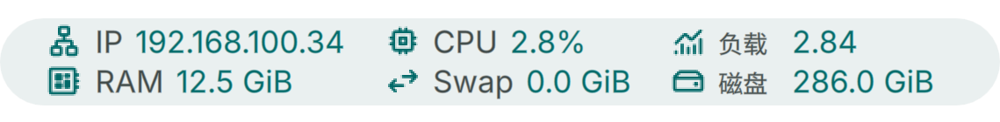
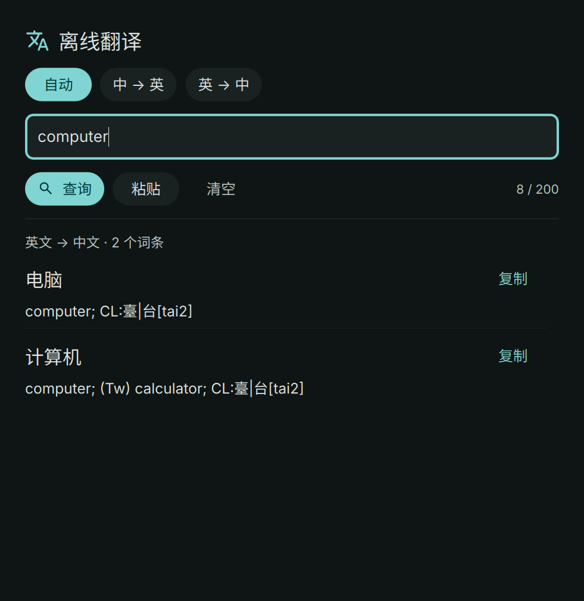
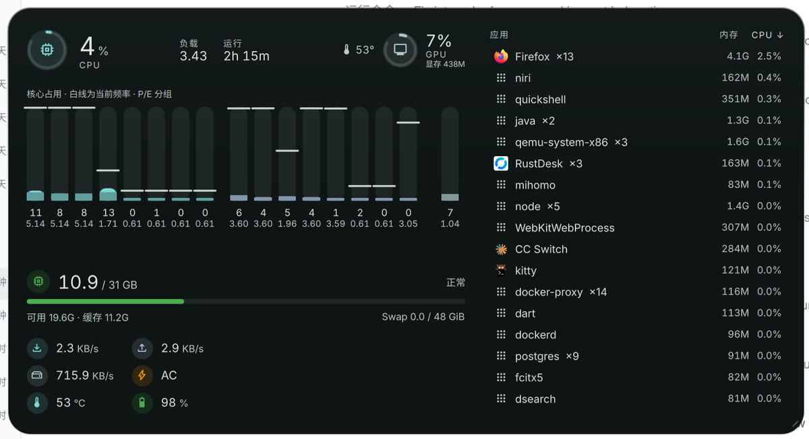

# DMS Plugins

为 [DankMaterialShell（DMS）](https://github.com/AvengeMedia/DankMaterialShell) 提供的本地插件。DMS 是用户安装在 Linux 桌面上的外壳，负责状态栏、启动器、通知等界面，并加载用户安装的插件。每个插件都可以独立安装、启用和放置，界面跟随 DMS 主题。

主要面向 Linux 的 Wayland 桌面。Wayland 是应用与桌面显示服务之间交换窗口内容的协议；niri 是用户安装、配置的窗口管理器，负责窗口、工作区和焦点，Focus 插件通过它管理专注期间的窗口。

| 插件 | 功能 | 详细说明 |
| --- | --- | --- |
| **LocalStatus** | IP、网络连接、CPU、系统负载、内存、Swap、磁盘剩余空间和时间；支持模块开关、单双行、列对齐及间距调节 | [安装、设置与开发](LocalStatus/README.md) |
| **LocalTranslate** | 内置 CC-CEDICT 词库，中文与英文双向离线查词；显示简体中文，支持词条和短语 | [安装、使用与词库许可](LocalTranslate/README.md) |
| **LocalLyrics** | 读取本地音乐文件的内嵌歌词，跟随播放进度显示；支持单双行、时间偏移及复原，无音乐时隐藏 | [安装、歌词来源与播放器支持](LocalLyrics/README.md) |
| **CachyosAgents** | Claude Code / Codex / OpenCode / DSH 等 AI 编程工具的 token 用量与费用统计；token 是模型处理文本的计量单位。读取本机采集结果，支持今天/近 7 天/累计、模型明细、额度条和默认工具切换 | [安装、数据来源与开发验证](CachyosAgents/README.md) |
| **连接（PhoneConnect）** | 手机无线配对、投屏和文件传输，以及电脑 RDP 远程桌面；可保存电脑地址、账号和显示选项 | [安装、手机与电脑连接](PhoneConnect/README.md) |
| **Focus** | 保持当前 niri 窗口，将其他应用随后打开的新窗口移入专用工作区，暂停 DMS 通知弹窗；退出时恢复此前配置和通知状态 | [构建、安装与功能边界](Focus/README.md) |
| **Top** | 仿 ftop 的悬浮系统面板：每核占用与频率、内存压力与可用/缓存、网络与磁盘速率、GPU 与显存、供电、温度、负载与运行时间，以及带 CPU/内存两列、可排序、可右键结束进程的应用列表；默认居中、仅热键呼出、点击面板外关闭 | [界面、安装与数据来源](Top/README.md) |

## 预览

### LocalStatus



### LocalTranslate



### LocalLyrics


### Top



图片由实际 DMS 组件渲染。歌词示例为原创测试文本，具体颜色由 DMS 主题决定。

## 获取源码与安装

```bash
mkdir -p ~/workspace
git clone git@github.com:skynit/dms-plugins.git ~/workspace/dms-plugins
cd ~/workspace/dms-plugins
```

各插件的 `plugin.json` 是供 DMS 读取的清单，由插件作者维护，声明插件 ID、界面入口、依赖和权限。它需要放在对应安装目录的顶层。插件 ID 是 DMS 命令识别插件时使用的名称，与源码目录和安装目录的大小写可能不同。

默认安装目录与插件 ID：

| 源码目录 | 默认安装目录 | 插件 ID |
| --- | --- | --- |
| `LocalStatus/` | `~/.config/DankMaterialShell/plugins/LocalStatus` | `localStatus` |
| `LocalTranslate/` | `~/.config/DankMaterialShell/plugins/localTranslate` | `localTranslate` |
| `LocalLyrics/` | `~/.config/DankMaterialShell/plugins/localLyrics` | `localLyrics` |
| `CachyosAgents/` | `~/.config/DankMaterialShell/plugins/CachyosAgents` | `cachyosAgents` |
| `PhoneConnect/` | `~/.config/DankMaterialShell/plugins/PhoneConnect` | `phoneConnect` |
| `Focus/` | `~/.config/DankMaterialShell/plugins/Focus` | `focus` |
| `Top/` | `~/.config/DankMaterialShell/plugins/Top` | `top` |

进入所需插件目录，按照表格中的详细说明复制运行文件。LocalTranslate、LocalLyrics、PhoneConnect、Focus 和 Top 还需要构建各自的 Go 辅助程序；辅助程序是由插件界面启动的本地进程，负责查词、读取歌词、连接手机、管理窗口或采集系统指标等工作。Go 用于构建这些程序，运行机器只需要构建产物及相应的外部命令。

例如，安装 PhoneConnect：

```bash
cd ~/workspace/dms-plugins/PhoneConnect
plugin_dir="${XDG_CONFIG_HOME:-$HOME/.config}/DankMaterialShell/plugins/PhoneConnect"
mkdir -p "$plugin_dir"
cp plugin.json PhoneConnect.qml PhonePopout.qml PhoneOptions.qml PhoneSource.qml ComputerConnect.qml ComputerSource.qml "$plugin_dir/"
GOAMD64=v1 CGO_ENABLED=0 go build -o "$plugin_dir/phone-connect" .
dms ipc call plugin-scan scan
dms ipc call plugins enable phoneConnect
```

`XDG_CONFIG_HOME` 用于指定用户配置根目录，未设置时使用 `~/.config`。上例中的 `GOAMD64=v1` 选择基础 x86-64 指令集，`CGO_ENABLED=0` 关闭对 C 运行库的链接；其他架构的构建方式见对应插件 README。

复制后让 DMS 扫描插件目录，再启用插件，并在 DMS 的状态栏设置中添加对应组件（Top 只有悬浮面板，不需要加入状态栏）。扫描、启用和状态栏放置是三个步骤；启用插件不会自动调整状态栏的位置。可用以下命令检查插件是否已发现和加载：

```bash
dms ipc call plugins list
dms ipc call plugin-scan status phoneConnect
```

更新时，先按对应插件 README 重新构建并复制运行文件，再使用该插件的 ID 定向重扫、重载。例如：

```bash
dms ipc call plugin-scan rescan phoneConnect
dms ipc call plugins reload phoneConnect
```

源码目录与安装目录是独立副本，`git pull` 不会自动更新已安装插件。DMS 可能缓存嵌套界面，重载后仍显示旧界面时，先重新打开弹窗；仍未更新时再按插件 README 的说明重启 DMS。更新 Focus 前需先关闭专注模式。

## 依赖与功能边界

运行环境为 Linux、DMS 和它配套的 Quickshell/Qt 6。Qt 6 提供界面运行库，Quickshell 基于它加载插件作者编写的 QML 界面文件。QML 用于描述状态栏、弹窗和设置控件，Go 辅助程序则处理后台工作。Focus 还需要 niri。

| 插件 | 清单声明的 DMS 最低版本 | 运行所需程序或数据 |
| --- | --- | --- |
| LocalStatus | `1.5.3` | `dgop` 提供系统资源采样，`ip` 读取网络接口 |
| LocalTranslate | `1.6.1` | 构建后的 `translate-lookup` 和随仓库提供的 SQLite 词典；SQLite 是保存词条及查询索引的本地数据库 |
| LocalLyrics | `1.6.1` | 构建后的 `lyrics-helper` 和 FFmpeg 的 `ffprobe`，后者负责读取音频标签 |
| CachyosAgents | `1.5.3` | `jq`、`python3`，以及 CachyOS 安装器提供的本机用量采集程序；详见插件 README |
| 连接（PhoneConnect） | `1.5.3` | 构建后的 `phone-connect`；手机需要 `adb`、`scrcpy`、`avahi-browse` 和 `avahi-daemon`；电脑 RDP 需要 `xfreerdp3`，密码自动保存需要 `secret-tool` 和系统密钥环 |
| Focus | `1.6.2` | 构建后的 `focus-helper`、`niri` 和 `dms`；当前按 niri `26.04` 的接口实现 |
| Top | `1.6.1` | 构建后的 `top-helper`；面板不依赖合成器背景模糊 |

- **LocalStatus** 展示即时状态，数据缺失或采样过期时保留具体原因，不将缺失数据显示成零。当前不包含历史曲线、网络速率或温度监控。
- **LocalTranslate** 只查询已收录的中英文词条和短语，不执行任意整句翻译。运行时不需要 Python；重新构建词典时才使用 Python 工具。
- **LocalLyrics** 通过 MPRIS 获取播放器状态。MPRIS 是播放器向桌面公开曲目、音频地址和进度的接口，由播放器提供，插件据此读取音频内嵌歌词；不搜索在线歌词或读取外置 LRC。缺少音频地址的 termusic 可通过本地媒体库匹配文件。
- **CachyosAgents** 读取本机采集结果，缺失数据明确显示为未采集或无数据。采集程序由 CachyOS 安装器配置，插件自身不包含所有工具的采集实现；单独复制插件不能替代采集环境。
- **PhoneConnect** 使用 ADB（Android 调试桥，由电脑上的 `adb` 与手机建立调试连接）传输命令和文件，再使用 `scrcpy` 创建投屏窗口。ADB 已连接与投屏已启动是两个状态；已有连接时直接投屏，断线后才尝试扫描、重连。无线连接需要手机开启无线调试，并与电脑处于可互通的局域网；Avahi 负责发现手机当前的配对端口和连接端口，配对与连接失败分别显示原因。文件推送目标为手机的 `/sdcard/Download/`。
- **Top** 直接读取 `/proc` 与 `/sys`，不依赖 `dgop`；只在面板可见时采样，隐藏 3 秒后停止 helper。功耗优先读 RAPL，普通用户无权限时显示电池放电功率或 `电源`，不请求提权。应用按可执行文件聚合，内核线程不计入列表。
- **Focus** 通过临时 niri 配置隔离其他应用的新窗口，并在焦点变化后请求切回原窗口，不修改用户的 niri 主配置。焦点切回可能短暂可见，部分系统浮层及紧急通知仍可能出现；退出时不会自动搬回专用工作区中的窗口，具体限制见插件 README。

## 开发验证

仅在所修改插件的目录执行对应命令，不运行全仓测试：

| 工作目录 | 测试命令 |
| --- | --- |
| `LocalStatus/` | `node --test tests/status.test.cjs` |
| `CachyosAgents/` | `node --test tests/usage.test.cjs` |
| `LocalTranslate/` | `CGO_ENABLED=0 go test . -count=1` |
| `LocalLyrics/` | `CGO_ENABLED=0 go test . -count=1` |
| `PhoneConnect/` | `CGO_ENABLED=0 go test . -count=1` |
| `Focus/` | `CGO_ENABLED=0 go test . -count=1` |
| `Top/helper/` | `gofmt -l . && go vet ./... && CGO_ENABLED=0 go test ./... -count=1` |

Go 版本和构建依赖见各插件的 `go.mod`，这是开发者维护的 Go 模块声明文件。LocalLyrics 的 Go 测试还需要 FFmpeg 生成本地音频样本。保留的 Python 脚本和测试用于词典构建或旧实现对照，不是上述 Go 插件的运行入口。

修改 QML 后，还应使用与 DMS 匹配的 Qt 6 `qmllint` 检查受影响文件，并在实际 DMS 中验证状态栏、弹窗和设置。独立检查工具缺少 DMS 的 `qs.*` 界面模块时，需结合实际加载日志判断。逻辑测试不能替代真实手机连接、窗口管理和界面操作的验收。

## 词库署名与许可

LocalTranslate 内置 CC-CEDICT 原始快照和派生 SQLite 索引，均遵循 **CC BY-SA 4.0**。分发时请保留 [词库署名与变更说明](LocalTranslate/data/NOTICE.md) 和 [完整许可](LocalTranslate/data/CC-BY-SA-4.0.txt)。该数据许可不代表插件源码采用相同许可。
